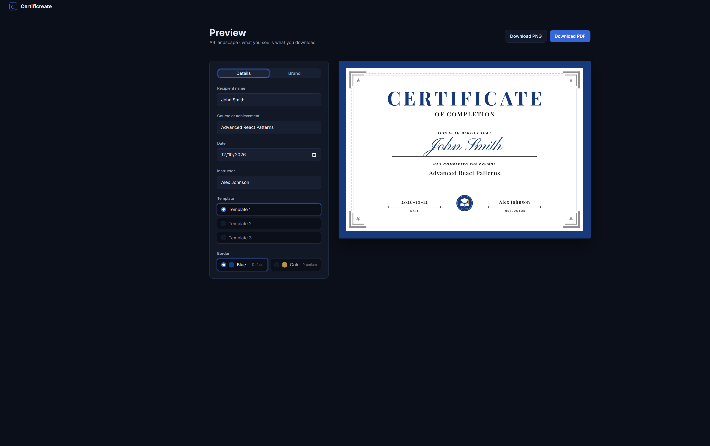
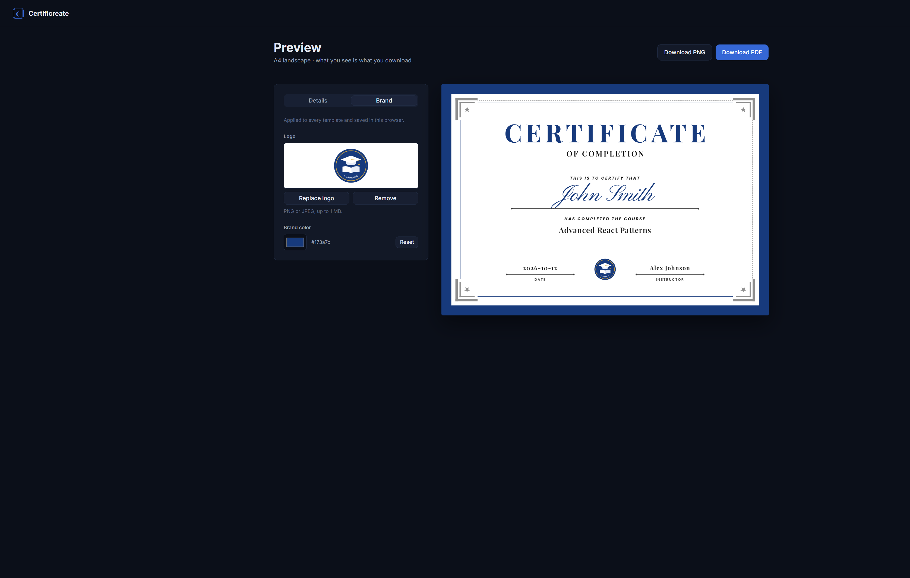

<h1 align="center">📜 Certificreate</h1>

<p align="center">
  Turn a name, a course, and a date into a polished course-completion certificate,
  then download it as a high-resolution PNG or a print-ready A4 PDF.
</p>

<p align="center">
  
  
  
  
  
  
  
  
  
</p>

<p align="center">
  
  <br />
  <em>The Details tab with the live A4 preview</em>
</p>

<p align="center">
  
  <br />
  <em>The Brand tab with an uploaded logo and brand color</em>
</p>

## Why I built it

[Academiq](https://github.com/Ahmed-HA-RE/academiq) is a full-stack learning
management system (LMS) I built. Instructors create and sell courses, and
students learn and track their progress.

Certificreate is a standalone project, but it's closely tied to Academiq. It's
where I'm building course-completion certificates, a feature I'm planning for
Academiq, on its own first. That let me focus on the hard parts without the rest
of the LMS around them: a certificate design that looks right, brand settings
like a logo and color, and rendering the same design pixel-perfectly to PNG and
PDF on a server. Once it's proven here, the same approach can move into Academiq,
so students get a certificate when they finish a course.

## Features

- **Live preview.** The preview is the real certificate scaled down, so what you
  see is exactly what you download.
- **Three templates**, all sharing one theme, with a blue (default) or gold
  (premium) border on each.
- **Brand settings.** Upload your logo (PNG or JPEG, up to 1 MB) to replace the
  placeholder badge, and pick a brand color to replace the navy.
- **PNG and PDF export.** A 3× high-resolution PNG, or a full-bleed A4 landscape
  PDF ready to print.
- **No account needed.** Brand settings are saved only in your browser.

## How export works

The preview and the export use the same React component. When you click
**Download PNG** or **Download PDF**, the browser sends the certificate details
to `POST /api/export/[format]`. The server validates them with Zod, then opens
the certificate in one shared headless Chrome (Puppeteer) and captures it as a
PNG or prints it to a PDF.

The server only uses the details to render the file. It never stores or logs
them.

## Tech stack

| Area | Tools |
| --- | --- |
| App | Next.js 16 (App Router), React 19, TypeScript |
| Styling | Tailwind CSS 4, shadcn/ui |
| Rendering | Puppeteer with bundled Chromium |
| Validation | Zod |
| Tests | Vitest |
| Hosting | Render web service |

## Getting started

You need Node.js and [pnpm](https://pnpm.io).

```bash
pnpm install   # also downloads Chrome for Puppeteer
pnpm dev
```

Then open http://localhost:3000.

| Command | Purpose |
| --- | --- |
| `pnpm dev` | Start the dev server |
| `pnpm build` | Production build (includes type checking) |
| `pnpm start` | Serve the production build |
| `pnpm lint` | Run ESLint |
| `pnpm test` | Run the unit tests (Vitest) |

## Deployment

Certificreate runs as a Render web service, because Puppeteer needs a persistent
container rather than serverless functions.

- **Build command:** `pnpm build`
- **Start command:** `pnpm start`
- **Chrome location:** `.puppeteerrc.cjs` keeps the downloaded Chrome inside the
  project, so it ships with the build.
- **Instance size:** use at least the Starter plan; Standard (2 GB) is better
  for Chrome's memory.

## Roadmap

- Certificate history: re-open and re-download past certificates, and
  remember the last form values
- Input polish: date formatting, validation, and auto-fit for long names
- Production hardening on Render
